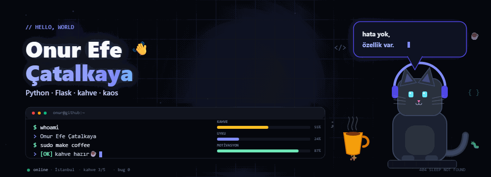
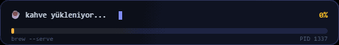

<div align="center">
  
</div>

<br>

<div align="center">
  
</div>

<br>

```console
$ whoami
> Onur Efe Çatalkaya

$ current_mode
> kod yazıyor... ☕

$ next_move
> kahve al, devam et.
```

Kod yazmayı, kahve içmeyi ve gereksiz `console.log` bırakmamayı severim. Bazen bir bug'ı üç saat ararım; sonra eksik virgül olduğunu görürüm. Bu da işin eğlenceli kısmı.

---

## Stack

<p align="center">
  
  
  
  
  
</p>

---

## Sistem durumu

| Metrik | Durum |
| :--- | :--- |
| ☕ Kahve | 🟨🟨🟨🟨🟨🟨🟨🟨⬛⬛ %80 |
| 😴 Uyku | 🟦🟦⬛⬛⬛⬛⬛⬛⬛⬛ %20 |
| 🐛 Bug | 0 (şimdilik) |
| 🎧 Müzik | lo-fi, 7/24 |
| 🧠 Motivasyon | 🟩🟩🟩🟩🟩🟩🟩🟩🟩🟩 %100 |

---

## Beni tanı

- Kahve içerken kod yazarım, kod yazarken kahve içerim. Döngüsel bir bağımlılık.
- Bir bug'ı bulmak için üç saat harcarım; sonra eksik virgül olduğunu görürüm.
- Lastik ördeğimle konuşurum. O da bana hak verir.
- `git commit -m "son kez"` benim en büyük yalanım.
- Klavye sesi benim için lo-fi.

---

## Bugünün modu

> “Çalışıyor. Neden çalışıyor bilmiyorum. Dokunma.”

---

## Bug bulursan

Issue aç, birlikte bakalım. Ben de bu arada kendi bug'larımı arıyorum. 🐛

[](https://github.com/onurcatalkaya/onurcatalkaya/issues/new)

---

## İletişim

Merhaba demek, teknik sohbet veya iş birliği için:

[](https://github.com/onurcatalkaya)

<div align="center">
  <sub>404 SLEEP NOT FOUND · made with ☕ & hata ayıklama</sub>
</div>
